# Konceptuālais modelis

Konceptuālais modelis ir balstīts uz prasību formulējumu (reģistrācija, diētas plānošana, kaloriju aprēķins, dzīvesveida analīze, filtrēšana).

## 1. Diagramma

- Lietotajs: Reprezentē jebkuru reģistrētu sistēmas lietotāju. Glabā piekļuves un identifikācijas datus un lietotāja lomu sistēmā.
- Profils: Glabā lietotāja fizikālos un personīgos datus uztura plānošanai. Katram Lietotājam ir tieši viens Profils.
- DietasPlans: Konkrēts uztura plāns noteiktam laika periodam. Lietotājs var izveidot vairākus plānus, kā arī plāns var tikt balstīts uz citu jau esošu veidnes plānu.
- Edienreize: Definē ēdienreizes veidu, dienu un porciju daudzumu. Apvieno Diētas plānu ar konkrētu Recepti.
- Recepte: Pagatavojama ēdiena apraksts. Glabā nosaukumu, aprakstu, pagatavošanas soļus, porciju skaitu un aprēķināto kaloriju daudzumu vienā porcijā.
- ReceptesSastavdala: Saisttabula starp recepti un produktu. Norāda, cik gramu konkrētā produkta ir nepieciešams konkrētajā receptē.
- Produkts: Pamata pārtikas produkts. Glabā produkta uzturvērtību uz 100 gramiem (kalorijas, olbaltumvielas, taukus, ogļhidrātus).
- Birka: Klasifikators/iepriekš definēti birku saraksti. Tiek izmantota, lai atzīmētu Receptes vai norādītu klienta vēlamo diētas veidu Profilā.
- AnalizesSesija: Konsultācija starp klientu un uztura speciālistu. Sasaista divus Lietotājus (klients un nutriciologs).

```mermaid
classDiagram
    direction LR

    class Lietotajs {
        string id
        string vārds
        string e_pasts
        string paroles_hešs
        string loma "klients | nutriciologs | administrators"
        Date reģistrācijas_datums
    }

    class Profils {
        number vecums
        string dzimums
        number augums_cm
        number svars_kg
        string aktivitātes_līmenis
        string mērķis "zaudēt | uzturēt | pieņemties"
        number dienas_kaloriju_mērķis
    }

    class DietasPlans {
        string id
        string nosaukums
        string veids
        Date sākuma_datums
        Date beigu_datums
        number kaloriju_mērķis
    }

    class Edienreize {
        Date diena
        string tips "brokastis | pusdienas | vakariņas | uzkoda"
        number porcijas
    }

    class Recepte {
        string id
        string nosaukums
        string apraksts
        string pagatavošanas_soļi
        number porciju_skaits
        number kalorijas_porcijā
    }

    class ReceptesSastavdala {
        number daudzums_g
    }

    class Produkts {
        string id
        string nosaukums
        number kcal_100g
        number olbaltumvielas_100g
        number tauki_100g
        number ogļhidrāti_100g
    }

    class Birka {
        string nosaukums
    }

    class AnalizesSesija {
        Date datums_laiks
        string statuss "pieteikta | notikusi | atcelta"
        string piezīmes
    }

    Lietotajs "1" -- "1" Profils : ir
    Lietotajs "1" -- "*" DietasPlans : izveido
    DietasPlans "1" *-- "*" Edienreize : sastāv no
    Edienreize "*" --> "1" Recepte : izmanto
    Recepte "1" *-- "*" ReceptesSastavdala : satur
    ReceptesSastavdala "*" --> "1" Produkts : norāda
    Recepte "*" -- "*" Birka : marķēta ar
    Profils "*" -- "*" Birka : vēlamais diētas veids
    Profils "*" -- "*" Produkts : izslēgti produkti
    Lietotajs "1" -- "*" AnalizesSesija : piesaka (klients)
    Lietotajs "1" -- "*" AnalizesSesija : vada (nutriciologs)
    AnalizesSesija "*" --> "0..1" DietasPlans : iesaka
```

## 2. Konceptu apraksts

| Koncepts | Apraksts | Saistītā prasība |
|---|---|---|
| Lietotājs | Sistēmas lietotājs ar lomu: klients, nutriciologs vai administrators | 1.1 (Reģistrācija) |
| Profils | Klienta fiziskie dati, mērķis, vēlamie diētas veidi un izslēgtie produkti; tiek saglabāts pēc reģistrācijas | 1.1 (Reģistrācija), 1.3 (Diētas plānošana) |
| Diētas plāns | Ēdienreižu kopums noteiktam periodam. Veidne ir gatavs plāns, ko klients var izvēlēties. Personīgs plāns ir klienta kopija, ko var modificēt | 1.3 (Diētas plānošana) |
| Ēdienreize | Viena konkrēta ēdienreize plānā (diena + tips) ar izvēlēto recepti un porciju skaitu | 1.3 (Diētas plānošana) |
| Recepte | Ēdiens ar pagatavošanas aprakstu un sastāvdaļām | 1.3 (Diētas plānošana), 1.5 (Filtrēšana) |
| Receptes sastāvdaļa | Saista recepti ar produktu un norāda daudzumu gramos | 1.2 (Kaloriju rēķināšana) |
| Produkts | Pamatprodukts ar uzturvērtību uz 100 g | 1.2 (Kaloriju rēķināšana) |
| Birka | Marķējums filtrēšanai (piem., veģetārs), kas tiek izmantots gan receptēm, gan klienta preferencēm | 1.5 (Filtrēšana) |
| Analīzes sesija | Klienta pieteikums dzīvesveida analīzei pie nutriciologa; rezultātā var tikt ieteikts plāns | 1.4 (Dzīvesveida analīze) |

## 3. Aprēķinātie lielumi

- **Receptes kalorijas** = Σ (sastāvdaļas daudzums_g / 100 × produkta kcal_100g)
- **Porcijas kalorijas** = receptes kalorijas / porciju skaits
- **Plāna dienas kalorijas** = Σ (ēdienreizes porcijas × porcijas kalorijas) attiecīgajā dienā
- **Dienas kaloriju mērķis** profilā tiek aprēķināts no vecuma, dzimuma, auguma, svara, aktivitātes līmeņa un mērķa (piem., ar Mifflin–St Jeor formulu)

## 4. Lietotāju stāstu pārklājums

| Nr. | Lietotāju stāsts | Koncepti |
|---|---|---|
| 1 | Apskatīt tikai veģetārās opcijas | Recepte, Birka |
| 2 | Reģistrēties un saglabāt preferences | Lietotājs, Profils, Birka, Produkts |
| 3 | Saplānot diētu | Diētas plāns, Ēdienreize, Recepte |
| 4 | Analizēt diētu un izvēlēties labāko plānu | Analīzes sesija, Diētas plāns |
| 5 | Aprēķināt maltītes kalorijas | Recepte, Receptes sastāvdaļa, Produkts |
