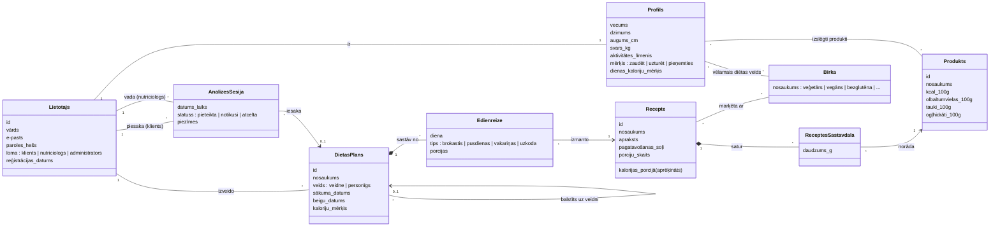

# Konceptu modelis

Konceptu modelis apraksta, **kas ir sistēmā** — galvenos jēdzienus, to atribūtus un savstarpējās saites. Tas ir balstīts uz prasību formulējumu (reģistrācija, diētas plānošana, kaloriju aprēķins, dzīvesveida analīze, filtrēšana).

## 1. Diagramma

## 2. Konceptu apraksts

| Koncepts | Apraksts | Saistītā prasība |
|---|---|---|
| Lietotājs | Sistēmas lietotājs ar lomu — klients, nutriciologs vai administrators | 1.1 Reģistrācija |
| Profils | Klienta fiziskie dati, mērķis, vēlamie diētas veidi un izslēgtie produkti; tiek saglabāts pēc reģistrācijas | 1.1, 1.3 |
| Diētas plāns | Ēdienreižu kopums noteiktam periodam. *Veidne* ir gatavs plāns, ko klients var izvēlēties; *personīgs* plāns ir klienta kopija, ko var modificēt | 1.3 Diētas plānošana |
| Ēdienreize | Viena konkrēta ēdienreize plānā (diena + tips) ar izvēlēto recepti un porciju skaitu | 1.3 |
| Recepte | Ēdiens ar pagatavošanas aprakstu un sastāvdaļām | 1.3, 1.5 |
| Receptes sastāvdaļa | Saista recepti ar produktu un norāda daudzumu gramos | 1.2 |
| Produkts | Pamatprodukts ar uzturvērtību uz 100 g — avots kaloriju aprēķinam | 1.2 Kaloriju rēķināšana |
| Birka | Marķējums filtrēšanai (piem., veģetārs); izmanto gan receptēm, gan klienta preferencēm | 1.5 Filtrēšana |
| Analīzes sesija | Klienta pieteikums dzīvesveida analīzei pie nutriciologa; rezultātā var tikt ieteikts plāns | 1.4 Dzīvesveida analīze |

## 3. Aprēķinātie lielumi

Kalorijas netiek glabātas ar roku — tās aprēķina no datiem:

- **Receptes kalorijas** = Σ (sastāvdaļas daudzums_g / 100 × produkta kcal_100g)
- **Porcijas kalorijas** = receptes kalorijas / porciju skaits
- **Plāna dienas kalorijas** = Σ (ēdienreizes porcijas × porcijas kalorijas) attiecīgajā dienā
- **Dienas kaloriju mērķis** profilā tiek aprēķināts no vecuma, dzimuma, auguma, svara, aktivitātes līmeņa un mērķa (piem., ar Mifflin–St Jeor formulu)

## 4. Lietotāju stāstu pārklājums

| Nr. | Lietotāju stāsts | Koncepti |
|---|---|---|
| 1 | Apskatīt tikai veģetārās opcijas | Recepte, Birka |
| 2 | Reģistrēties un saglabāt preferences | Lietotājs, Profils, Birka, Produkts |
| 3 | Saplānot diētu | Diētas plāns, Ēdienreize, Recepte |
| 4 | Analizēt diētu un izvēlēties labāko plānu | Analīzes sesija, Diētas plāns |
| 5 | Aprēķināt maltītes kalorijas | Recepte, Receptes sastāvdaļa, Produkts |
